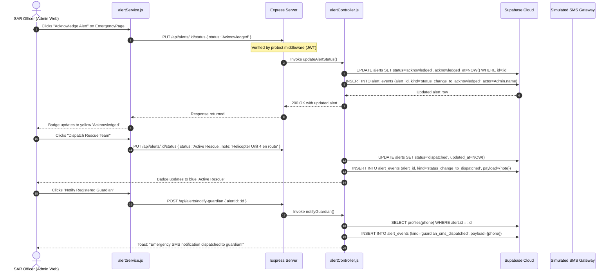
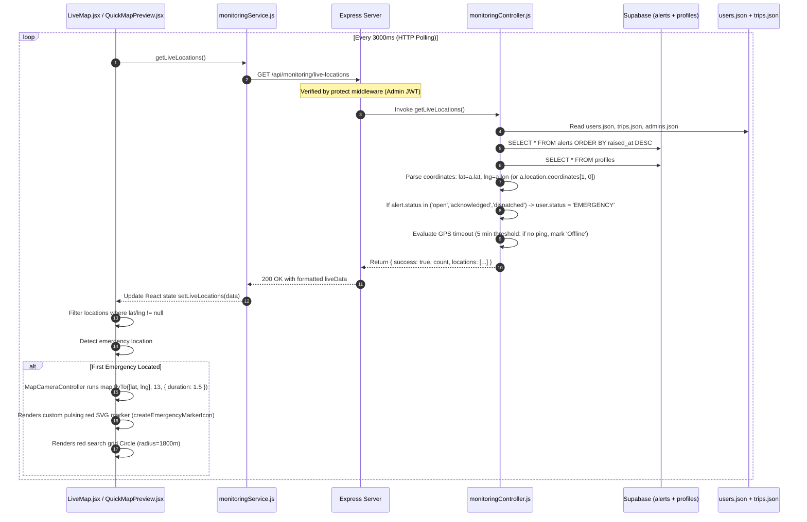

# 01 — ARCHITECTURE AND DATA FLOW

> **System Name:** Smart Tourist Safety Monitoring System (STSMS)  
> **Core Architecture:** 3-Tier Distributed Architecture (Mobile Client + Node.js REST API + Supabase PostgreSQL/PostGIS) with Polling-Based Web Dashboard

---

## 1. High-Level System Architecture Diagram

```mermaid
graph TB
    subgraph "Client Layer"
        MA["Tourist Mobile App<br/>(React Native / Expo SDK 58)<br/>Port 8081 / Real Device"]
        WA["Admin Command Center<br/>(React 18 + Vite + Leaflet)<br/>Port 3009"]
    end

    subgraph "API & Processing Layer (Node.js Express - Port 5001)"
        GW["Express Server (server.js)<br/>CORS, JSON Parser, Error Handler"]
        
        subgraph "Route Modules"
            R_SOS["/api/alerts<br/>(alertRoutes.js)"]
            R_MON["/api/monitoring<br/>(monitoringRoutes.js)"]
            R_TRIP["/api/trips<br/>(tripRoutes.js)"]
            R_AUTH["/api/auth<br/>(authRoutes.js)"]
            R_HAZ["/api/hazards<br/>(hazardRoutes.js)"]
            R_DASH["/api/dashboard<br/>(dashboardRoutes.js)"]
        end

        subgraph "Background Daemons"
            DMS["Dead Man's Switch Daemon<br/>(deadManSwitchService.js)<br/>15-Second Automated Check Loop"]
        end

        MW["Auth Middleware<br/>(authMiddleware.js - JWT Verify)"]
    end

    subgraph "Persistence & Cloud Layer"
        subgraph "Supabase Cloud (PostgreSQL + PostGIS)"
            TBL_ALERTS[("alerts<br/>(PostGIS POINT, lat/lon generated)")]
            TBL_EVENTS[("alert_events<br/>(Audit log)")]
            TBL_PROFILES[("profiles<br/>(Traveler details)")]
        end

        subgraph "Local Fallback / Cache Layer (server/json/)"
            JSON_USERS[("users.json")]
            JSON_TRIPS[("trips.json")]
            JSON_ADMINS[("admins.json")]
            JSON_HAZ[("hazards.json")]
        end
    end

    MA -- "POST /api/alerts/sos (GNSS + Bat)" --> R_SOS
    MA -- "POST /api/monitoring/location-update" --> R_MON
    MA -- "POST /api/trips/:id/checkin" --> R_TRIP
    
    WA -- "GET /api/alerts (3s Polling)" --> R_SOS
    WA -- "GET /api/monitoring/live-locations (3s Polling)" --> R_MON
    WA -- "PUT /api/alerts/:id/status" --> R_SOS
    WA -- "GET /api/dashboard/stats" --> R_DASH

    R_SOS --> MW
    R_MON --> MW
    R_DASH --> MW

    R_SOS -- "Supabase Client (Service-Role Key)" --> TBL_ALERTS
    R_SOS --> TBL_EVENTS
    R_SOS -- "Sync emergency status" --> JSON_USERS
    
    R_MON -- "Select active alerts" --> TBL_ALERTS
    R_MON -- "Select profiles" --> TBL_PROFILES
    R_MON -- "Merge telemetry" --> JSON_USERS
    R_MON --> JSON_TRIPS

    DMS -- "Check trip deadlines" --> JSON_TRIPS
    DMS -- "Auto-dispatch emergency" --> TBL_ALERTS
```



---

## 2. Component Breakdown & Verified Communication Protocols

### A. Mobile-to-Backend Communication
- **Protocol:** HTTP/1.1 REST over JSON.
- **Port:** Target port is `5001`.
- **Base URL Resolution:** Handled by `stsms-mobile/app/utils/api.js`. The app dynamically parses `Constants.expoConfig?.hostUri` to extract the computer's LAN IP address (e.g., `10.140.187.216` or `192.168.1.X`), or uses custom server URL saved in AsyncStorage (`stsms_custom_server_url`).
- **Timeout:** Enforced via `AbortController` at 8000ms (8 seconds) to accommodate high-latency mobile edge networks.
- **Payload Sanitization:** No fabricated telemetry is ever sent. If GPS permissions are denied or satellites are obstructed, `location` is transmitted as `null`.

### B. Frontend-to-Backend Communication
- **Protocol:** HTTP/1.1 REST.
- **Development Proxy:** Configured in `vite.config.js`:
  ```javascript
  server: {
    port: 3009,
    proxy: {
      '/api': {
        target: 'http://localhost:5001',
        changeOrigin: true
      }
    }
  }
  ```
- **Authentication:** Admin requests attach `Authorization: Bearer <stsms_admin_token>` read from browser `localStorage`.
- **Polling Loop:** Built inside `src/App.jsx` and `src/components/Map/QuickMapPreview.jsx` using `setInterval(..., 3000)`.

### C. Backend-to-Supabase Communication
- **Client:** `@supabase/supabase-js` (v2.118.0) instantiated in `server/database/supabase.js`.
- **Authentication Method:** Configured with `process.env.SUPABASE_SERVICE_ROLE_KEY`. This provides full server-side administrative access that bypasses PostgreSQL Row-Level Security (RLS) policies for SAR dispatch.
- **Spatial Transformation:** Coordinates are converted to Well-Known Text (WKT):
  `row.location = 'POINT(' + lng + ' ' + lat + ')'`
  *Note:* In PostGIS, the X coordinate (Longitude) must precede the Y coordinate (Latitude).
- **Generated Columns:** Supabase automatically computes decimal latitude and longitude columns (`lat` and `lon`) from the spatial geometry column.

---

## 3. Detailed Sequence Diagrams

### Sequence A: Tourist Manually Presses SOS (End to End)

```mermaid
sequenceDiagram
    autonumber
    actor Tourist as Tourist (Expo App)
    participant ExpoLoc as expo-location / expo-battery
    participant MobService as emergencyService.js
    participant Server as Node.js Express (/api/alerts/sos)
    participant AlertCtrl as alertController.js
    participant Supabase as Supabase Cloud (PostgreSQL)
    participant LocalDB as server/json/users.json
    actor SAR as Admin Command Center

    Tourist->>MobService: Taps 1-Tap SOS Button
    MobService->>ExpoLoc: Query getCurrentPositionAsync() & getBatteryLevelAsync()
    ExpoLoc-->>MobService: Returns {lat, lng, accuracy} & battery percentage (e.g. 84%)
    
    alt Online Cellular / Wi-Fi
        MobService->>Server: POST /api/alerts/sos (JSON payload with telemetry)
        Server->>AlertCtrl: Invoke createSosAlert()
        AlertCtrl->>AlertCtrl: Validate location & battery (no fabrication)
        AlertCtrl->>Supabase: SELECT active alert WHERE trip_id = ? AND status in ('open','acknowledged')
        
        alt Existing Active Alert Found (Unique Constraint 23505 Mitigation)
            AlertCtrl->>Supabase: UPDATE alerts SET battery=?, location=?, updated_at=NOW()
        else No Prior Active Alert
            AlertCtrl->>Supabase: INSERT INTO alerts (user_id, trip_id, state='sos', location=POINT(lng lat), battery=...)
        end

        AlertCtrl->>Supabase: INSERT INTO alert_events (alert_id, kind='sos_raised', payload=...)
        AlertCtrl->>LocalDB: Update users.json (status='EMERGENCY', lastPing=NOW())
        AlertCtrl-->>Server: 201 Created (or 200 Updated)
        Server-->>MobService: Returns { success: true, alert: { id, status, lat, lng } }
        MobService-->>Tourist: Renders green confirmation banner with Alert ID
    else Zero Network / Offline Dead Zone
        MobService->>Tourist: Network error caught; triggers triggerOfflineNativeSmsFallback()
        MobService->>Tourist: Opens native device SMS composer with pre-filled Google Maps GNSS coordinates
    end

    Note over SAR: Within 3 seconds, Admin polling fetches /api/alerts
    SAR->>SAR: Detects new Alert ID -> Fires toast.error() & audio chime
    SAR->>SAR: Leaflet MapCameraController executes map.flyTo([lat, lng], 13)
```

---

### Sequence B: Admin Acknowledges & Dispatches SOS



---

### Sequence C: Live Monitoring Map Retrieves & Renders Active SOS



---

## 4. Concurrency, Race Condition, & Integrity Safeguards

1. **Unique Constraint Handling (`one_live_alert_per_trip`):**
   - The PostgreSQL database enforces that a single expedition cannot have multiple simultaneous unhandled alerts.
   - If an edge-network lag causes the tourist app to send duplicate SOS requests, the database rejects the second with PostgreSQL error `23505`.
   - `alertController.js` catches code `23505` and automatically pivots to an `UPDATE` on the active record with the newest battery and coordinate fix.
2. **Mobile Submission Lock (`submitLockRef.current`):**
   - In `HomeScreen.jsx`, an asynchronous mutex lock prevents multiple simultaneous button presses while an API call is in flight.
3. **GPS Freshness Window (`GPS_TIMEOUT_MS = 300,000`):**
   - In `monitoringController.js`, if a user has not transmitted a location update in the last 5 minutes, their status is dynamically downgraded from `Online` to `Offline`, and their stale duration is calculated in minutes.
