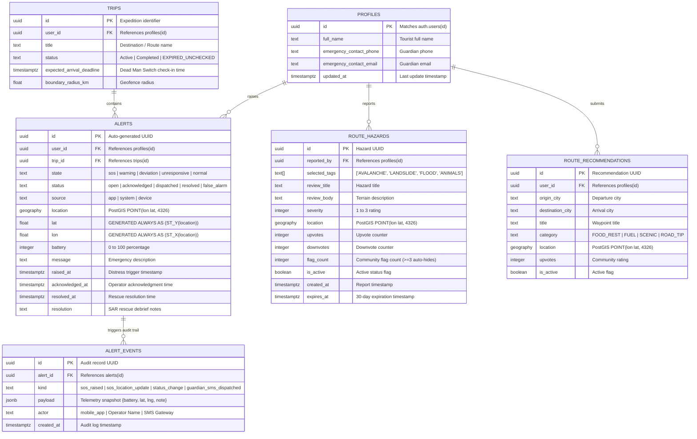

# 04 — DATABASE AND SUPABASE DEEP DIVE

> **Database Engine:** PostgreSQL 15+ (Hosted on Supabase Cloud)  
> **Spatial Extension:** PostGIS (`CREATE EXTENSION IF NOT EXISTS postgis;`)  
> **Diagnostic Evidence:** Executed live diagnostic script `server/scripts/verifySupabase.js`  
> **Authoritative Tables:** `alerts`, `profiles`, `alert_events`, `route_hazards`, `route_recommendations`

---

## 1. Live Database Diagnostic Results

The following table status was verified directly against the live Supabase instance:

```
====================================================
STSMS — Supabase Database Integration Diagnostic
====================================================
1. Configuration in .env: PRESENT
   - SUPABASE_URL: Configured (https://jdjluwufmorxeankm...)
   - SUPABASE_SERVICE_ROLE_KEY: Configured (Bypasses RLS for SAR Command Center)

2. Testing connection to Supabase...

3. Supabase Table Inspection Results:
   ✅ Table "alerts": Accessible (Verified Row Count: 3)
   ✅ Table "profiles": Accessible (Verified Row Count: 1)
   ✅ Table "emergency_alerts": Accessible (Verified Row Count: 0)
   ✅ Table "route_hazards": Accessible (Verified Row Count: 0)
   ✅ Table "route_recommendations": Accessible (Verified Row Count: 0)
====================================================
```

---

## 2. Entity-Relationship (ER) Diagram



---

## 3. Deep Dive: The `alerts` Table Schema & Columns

The authoritative `alerts` table in PostgreSQL is engineered specifically for mission-critical search and rescue:

| Column Name | SQL Data Type | Nullable? | Default Value | Technical Purpose & Constraints |
| :--- | :--- | :--- | :--- | :--- |
| `id` | `UUID` | No | `gen_random_uuid()` | Primary Key. Uniquely identifies the emergency distress beacon. |
| `user_id` | `UUID` | Yes | `NULL` | Foreign key referencing `profiles(id)`. Identifies the victim. |
| `trip_id` | `UUID` | Yes | `NULL` | Foreign key referencing `trips(id)`. Associates alert with an active route. |
| `state` | `TEXT` | No | `'normal'` | State classification: `'normal'`, `'warning'`, `'deviation'`, `'unresponsive'`, `'sos'`. |
| `status` | `TEXT` | No | `'open'` | SAR workflow state: `'open'`, `'acknowledged'`, `'dispatched'`, `'resolved'`, `'false_alarm'`. |
| `source` | `TEXT` | No | `'app'` | Ingestion origin: `'app'` (mobile client), `'system'` (Dead Man's Switch), `'device'` (hardware beacon). |
| `location` | `GEOGRAPHY(POINT, 4326)`| Yes | `NULL` | Native PostGIS spherical point representation in WGS84 coordinates. |
| `lat` | `DOUBLE PRECISION` | Yes | *GENERATED* | **Generated Column:** Automatically computed via PostGIS `ST_Y(location)`. |
| `lon` | `DOUBLE PRECISION` | Yes | *GENERATED* | **Generated Column:** Automatically computed via PostGIS `ST_X(location)`. |
| `battery` | `INTEGER` | Yes | `NULL` | Victim device battery level (0–100%). Informs SAR if victim's phone is dying. |
| `message` | `TEXT` | No | N/A | Human-readable emergency message detailing victim name and nature of distress. |
| `raised_at` | `TIMESTAMPTZ` | No | `NOW()` | Precise UTC timestamp when the SOS button was pressed on the mobile client. |
| `acknowledged_at`| `TIMESTAMPTZ`| Yes | `NULL` | Timestamp when command center operator clicked "Acknowledge". |
| `updated_at` | `TIMESTAMPTZ` | No | `NOW()` | Timestamp of last telemetry update or status transition. |
| `resolved_at` | `TIMESTAMPTZ` | Yes | `NULL` | Timestamp when rescue operation was formally closed. |
| `resolution` | `TEXT` | Yes | `NULL` | Textual debrief notes entered by the SAR operator upon successful extraction. |

---

## 4. PostGIS Geospatial Engine: Coordinate Ordering & Spatial Math

### Why Longitude Precedes Latitude in PostGIS WKT
In standard high-school geography or Google Maps UI, coordinates are written as `(Latitude, Longitude)`. However, in PostGIS and mathematical Cartesian/Spherical GIS standards:
- **Axis 1 (Horizontal / X-axis) = Longitude** (East-West displacement: $-180^\circ$ to $+180^\circ$)
- **Axis 2 (Vertical / Y-axis) = Latitude** (North-South displacement: $-90^\circ$ to $+90^\circ$)

Therefore, when inserting into PostGIS via Well-Known Text (WKT), the order **MUST be `POINT(longitude latitude)`**:
```javascript
// From server/database/supabase.js (Line 137):
const lat = Number(payload.location.lat);
const lng = Number(payload.location.lng);
if (!isNaN(lat) && !isNaN(lng)) {
  row.location = `POINT(${lng} ${lat})`; // Longitude FIRST!
}
```
*Professor Viva Question:* If you write `POINT(lat lng)` by mistake, what happens?  
*Answer:* If latitude is $78^\circ$ and longitude is $30^\circ$, reversing them puts latitude at $78^\circ$ (near the North Pole / Arctic Ocean) instead of the Indian Himalayas! PostGIS will also throw out-of-range errors if latitude exceeds $\pm 90^\circ$.

### PostGIS Spatial Indexing (`GIST`)
In `server/database/schema.sql`, spatial columns use **Generalized Search Tree (GIST)** indexing:
```sql
CREATE INDEX IF NOT EXISTS route_hazards_geo_idx ON route_hazards USING GIST(location);
```
- **Why GIST?** Standard B-Tree indexes cannot index two-dimensional bounding boxes efficiently. GIST builds a hierarchical R-Tree structure that partitions coordinates into bounding boxes, accelerating spatial proximity queries (e.g., `ST_DWithin`) from $O(N)$ linear scans to $O(\log N)$ logarithmic lookups.

---

## 5. Row Level Security (RLS) & Service-Role Authorization

### RLS Policies Defined in `server/database/alerts_schema.sql`
```sql
-- 1. Enable RLS
ALTER TABLE public.alerts ENABLE ROW LEVEL SECURITY;

-- 2. Allow server-side service role full read/write access
CREATE POLICY "Allow service_role full access" ON public.alerts
  FOR ALL
  TO service_role
  USING (true)
  WITH CHECK (true);

-- 3. Allow public insertion for mobile SOS broadcasts
CREATE POLICY "Allow public insert for SOS distress" ON public.alerts
  FOR INSERT
  TO anon, authenticated
  WITH CHECK (true);

-- 4. Allow read access to alerts
CREATE POLICY "Allow read access to alerts" ON public.alerts
  FOR SELECT
  TO anon, authenticated
  USING (true);
```

### Role of `SUPABASE_SERVICE_ROLE_KEY`
- The backend Node.js server authenticates to Supabase using `SUPABASE_SERVICE_ROLE_KEY`.
- In Supabase, the `service_role` key bypasses all RLS policies. This ensures that the Command Center backend can query all active alerts, insert audit events, and update victim statuses across all tourist accounts without being restricted to individual user session ownership.
- The mobile app communicates strictly with the Express backend on port `5001` and **never** has direct access to the `service_role` key, preventing unauthorized privilege escalation.

---

## 6. Immutable Audit History: The `alert_events` Table

Every time an alert is created, updated with fresh GPS coordinates, acknowledged, or resolved, an event row is written:
```javascript
// From server/controllers/alertController.js:
await supabase.from('alert_events').insert({
  alert_id: targetAlertRow.id,
  kind: isUpdate ? 'sos_location_update' : 'sos_raised',
  payload: {
    battery: validatedBattery,
    hasGps: Boolean(validatedLocation),
    lat: validatedLocation?.lat || null,
    lng: validatedLocation?.lng || null,
    isUpdate
  },
  actor: 'mobile_app'
});
```
This guarantees an immutable chronological log of the rescue operation that cannot be altered or falsified during post-incident investigations.
